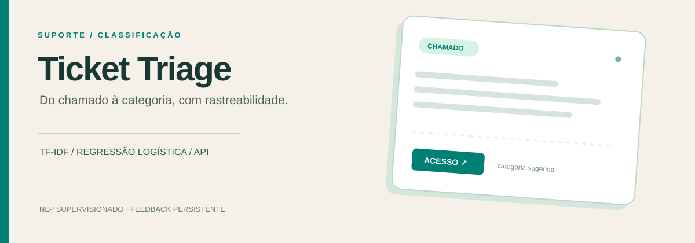
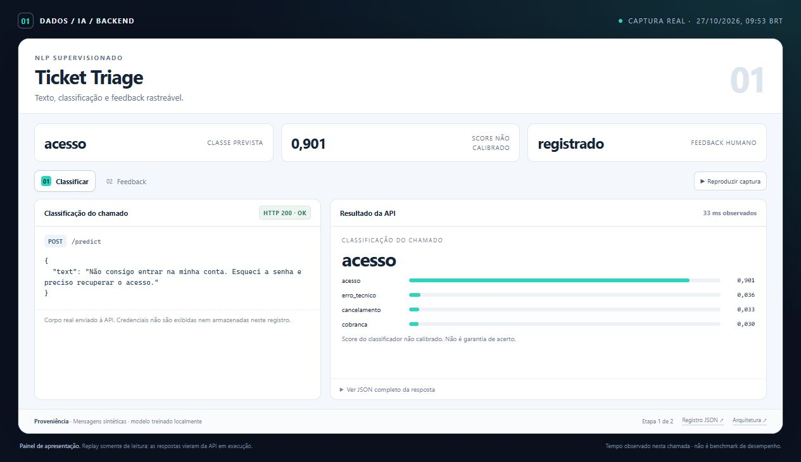
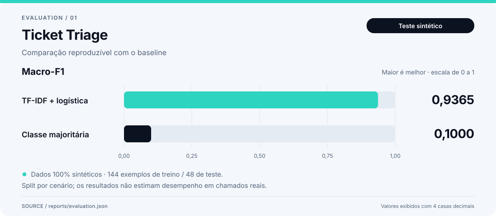
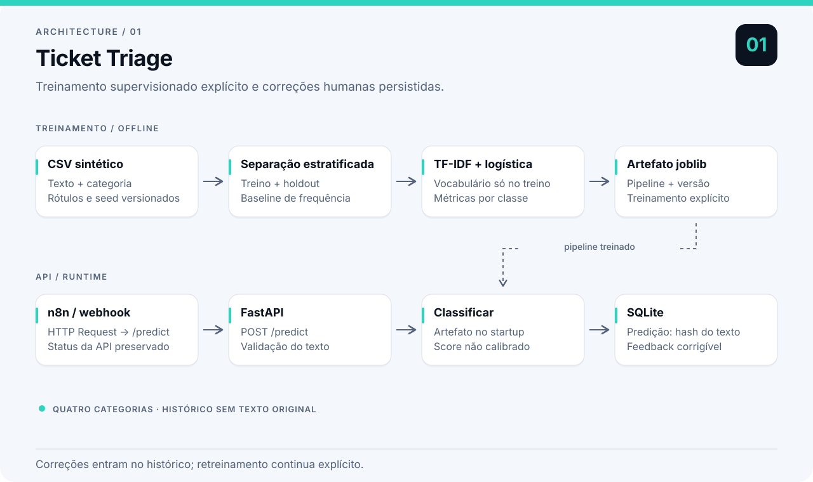

# Ticket Triage

Um chamado chega em texto livre. A API sugere uma das quatro categorias — **acesso, cancelamento, cobrança ou erro técnico** — e registra a predição para que possa receber uma correção humana.

O classificador combina **TF-IDF e regressão logística**. FastAPI expõe a previsão; SQLite guarda o histórico mínimo e o feedback. Um workflow n8n demonstra a integração por webhook.

> O modelo é treinado com 192 chamados sintéticos. A avaliação mede esse cenário controlado, não o desempenho em atendimentos reais.

## Um chamado em ação

No exemplo registrado, uma mensagem sobre acesso é classificada e depois recebe feedback. A captura mostra a resposta da API; o GIF percorre as etapas.



<details><summary>Ver as etapas em movimento</summary>


</details>

[Painel local](docs/demo/index.html) · [Registro da execução](docs/demo/run.json) · [Chamada adicional no Swagger](docs/assets/api-docs.jpg)

## Contrato e persistência

| Rota | Comportamento |
|---|---|
| `GET /health` | Prontidão do modelo: 200 ou 503 |
| `POST /predict` | Valida texto, classifica e registra a predição |
| `GET /predictions?limit=20` | Histórico recente, de 1 a 100 registros |
| `PUT /predictions/{id}/feedback` | Cria ou corrige um rótulo humano; ID desconhecido retorna 404 |

SQLite registra identificador, horário UTC, hash do texto, classe, score e versão do modelo. **O texto original não é persistido.** O hash serve para comparação de entradas, não para anonimização garantida; mensagens previsíveis podem ser adivinhadas. Feedback é separado da predição e não dispara retreinamento. Sem os textos, ele não é um novo dataset de treinamento.

Configure `TICKET_MODEL_PATH` e `TICKET_DB_PATH` no ambiente do processo para alterar os caminhos. Exemplo PowerShell: `$env:TICKET_DB_PATH='var/another.sqlite3'`. O arquivo `.env.example` é documentação; não há carregamento automático de `.env`.

## Executar

Requer Python 3.11 ou superior. Execute os comandos dentro deste diretório.

```powershell
python -m venv .venv
.\.venv\Scripts\Activate.ps1
python -m pip install -r requirements.lock
python -m pip install --no-deps -e .
python -m ticket_triage.train
python -m uvicorn ticket_triage.api:app --host 127.0.0.1 --port 8001
```

Em macOS/Linux, troque a ativação por `source .venv/bin/activate`; os demais comandos são iguais. As dependências exatas da execução registrada estão em `requirements.lock`. Para desenvolver com versões compatíveis mais recentes, use `python -m pip install -e '.[dev]'` e reavalie o modelo.

A documentação interativa fica em <http://127.0.0.1:8001/docs>. Treine antes de iniciar o servidor: sem `var/model.joblib`, `/health` e `/predict` retornam 503. O artefato é carregado uma vez na inicialização.

```powershell
$body = @{text='Minha senha foi recusada e não consigo fazer login'} | ConvertTo-Json
$result = Invoke-RestMethod http://127.0.0.1:8001/predict -Method Post -ContentType 'application/json' -Body ([Text.Encoding]::UTF8.GetBytes($body))
$result
$feedback = @{correct_label='acesso'} | ConvertTo-Json
Invoke-RestMethod "http://127.0.0.1:8001/predictions/$($result.prediction_id)/feedback" -Method Put -ContentType 'application/json' -Body $feedback
```

Em Unix:

```bash
curl -X POST http://127.0.0.1:8001/predict \
  -H 'Content-Type: application/json' \
  -d '{"text":"Minha senha foi recusada e não consigo fazer login"}'
```

## Evidência do modelo



Macro-F1 no holdout sintético; o cenário de avaliação e seus limites estão descritos abaixo.

O dataset versionado tem **192 exemplos inteiramente sintéticos**, agrupados em 48 cenários. As quatro variações de um mesmo cenário sempre ficam juntas: 144 exemplos no treino e 48 no holdout. O vocabulário TF-IDF é ajustado apenas no treino.

Resultados da execução registrada em [reports/evaluation.json](reports/evaluation.json):

| Modelo | Macro-F1 no holdout |
|---|---:|
| Classe mais frequente | 0,1000 |
| TF-IDF + regressão logística | 0,9365 |

Essa avaliação verifica o comportamento dentro do gerador. Ela **não estima qualidade em chamados reais**: as categorias têm vocabulário evidente, o conjunto é pequeno e não inclui mensagens ambíguas, múltiplos assuntos ou dados fora do domínio. O relatório registra cenários de cada partição, hash do CSV, versão do scikit-learn, matriz de confusão e exemplos incorretos. Não houve busca de hiperparâmetros no holdout.

O campo `score` é a saída de `predict_proba` do classificador e **não foi calibrado**. Um score de 0,8 não significa que o sistema acertará 80% desses casos. A API sempre escolhe uma das quatro classes; ela não detecta assunto desconhecido.

## Fluxo do classificador



Do CSV ao classificador e à API, com histórico mínimo e feedback humano persistidos em SQLite. Veja as [decisões técnicas](ARCHITECTURE.md).

## n8n

Importe [n8n/ticket-triage.json](n8n/ticket-triage.json), de ID `portfolioTicket1`. O Webhook recebe `{"text":"..."}`, chama `/predict` e devolve o corpo e o status HTTP da API, incluindo erros de validação 422. O arquivo vem **inativo**, sem credenciais e sem envio para terceiros.

A URL interna usa o DNS Compose `http://ticket-triage:8001/predict`. O [guia da integração](n8n/README.md) explica os mounts, a publicação via CLI, o restart necessário e as alternativas para API fora do Compose.

O teste `python n8n/verify_webhook.py --report n8n/validation.json` chama `/webhook/ticket-triage` por HTTP real e verifica previsão, texto inválido e preservação da validação de campos extras. Requer o n8n publicado e a API rodando; não usa mocks.

Os três casos passaram com n8n 2.44.7 e a API em contêiner. Veja o [registro da validação](n8n/validation.json).

## Verificar e reproduzir

```powershell
pytest -q
python -m ticket_triage.generate --output data/tickets.csv --seed 42
python -m ticket_triage.train --seed 42
```

Os testes cobrem separação por cenário, ausência de vocabulário exclusivo do holdout no TF-IDF, reprodutibilidade do dataset, validação da API, histórico, atualização do feedback e prontidão sem modelo.

```powershell
docker build -t ticket-triage .
docker run --rm -p 127.0.0.1:8001:8001 ticket-triage
```

O Dockerfile treina durante o build e executa como usuário sem privilégios. A imagem foi construída e a API participou da validação HTTP real no Compose do ambiente local. Sem volume, o histórico do contêiner é descartado ao removê-lo. O GitHub Actions executa os testes automaticamente.
