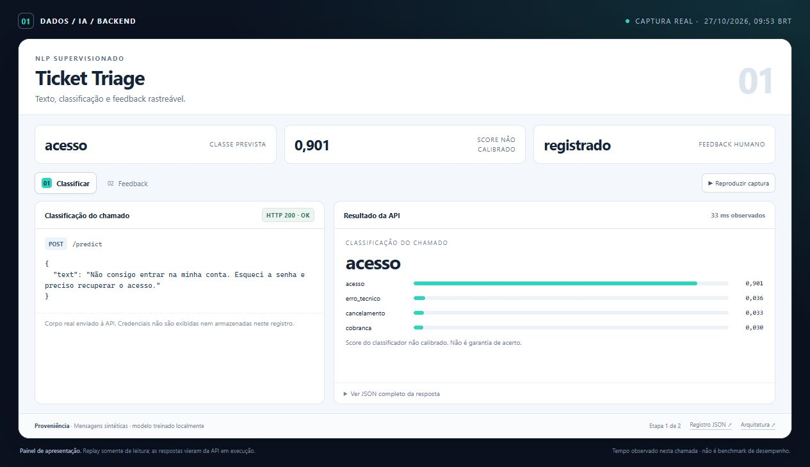
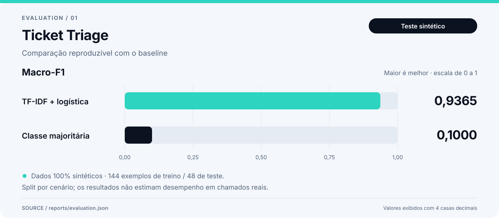

# Demonstração — Ticket Triage

O painel de demonstração mostra o backend por meio de respostas reais da API, coletadas em uma execução local. O screenshot e a animação são capturas desse painel renderizado no navegador.



[Ver animação](assets/demo.gif) · [Abrir o painel local](demo/index.html) · [Inspecionar o registro bruto](demo/run.json) · [Voltar ao README](../README.md)

## O que observar

- Um chamado em português recebe classe, scores e versão do modelo.
- O feedback de demonstração fica vinculado à predição original.
- O gráfico de Macro-F1 vem do holdout registrado e fica separado dos scores desta mensagem.

## Dados e evidências

Os chamados, cenários e rótulos são sintéticos. O dataset versionado tem 192 exemplos; as métricas se referem ao holdout desse gerador. A classificação é executada pelo modelo local, sem serviço de linguagem externo.

Relatório técnico complementar: [resultado registrado](../reports/evaluation.json).

`demo/run.json` conserva requests, respostas HTTP, códigos de status, duração e verificações de cada etapa. A seção `supporting_evidence` identifica os relatórios offline associados, incluindo seus hashes. Valores de avaliações anteriores continuam identificados como relatórios registrados, separados das respostas HTTP da execução capturada.



Macro-F1 no holdout sintético; o cenário de avaliação e seus limites estão descritos no README. Fonte: [relatório registrado](../reports/evaluation.json).

## Registro da captura

| Informação | Origem |
| --- | --- |
| Início da execução, UTC | `2026-10-27T12:53:33.965080+00:00` |
| Fim da execução, UTC | `2026-10-27T12:53:34.032184+00:00` |
| Respostas e verificações | [demo/run.json](demo/run.json) |
| Painel com dados incorporados | [demo/index.html](demo/index.html) |
| Captura no navegador | [assets/screenshot.jpg](assets/screenshot.jpg) |
| Fluxo animado | [assets/demo.gif](assets/demo.gif) |
| Swagger: captura adicional independente | [assets/api-docs.jpg](assets/api-docs.jpg) |

Os timestamps acima pertencem à coleta da API. A imagem e o GIF documentam a apresentação desses dados no navegador. Abrir o HTML preserva o registro capturado; novas chamadas à API exigem o ambiente em execução.

A captura adicional do Swagger mostra uma requisição executada no navegador e sua resposta HTTP 200. Essa chamada é independente; o JSON acima corresponde à coleta usada no painel e no GIF.

## Reproduzir

Siga o setup no [README](../README.md) e execute, na raiz deste projeto:

```powershell
python -m ticket_triage.train
python -m uvicorn ticket_triage.api:app --host 127.0.0.1 --port 8001
```

A API usa a porta `8001`. Os exemplos HTTP e as configurações de ambiente estão no README. O painel local pode ser aberto pelo arquivo `docs/demo/index.html`, que incorpora os dados capturados e permite percorrer as etapas sem consultar os serviços.

O screenshot facilita a leitura inicial; o JSON, os testes e os comandos permitem verificar o comportamento apresentado. Uma execução capturada documenta aquele cenário e ambiente, com os limites de dados descritos neste projeto.
